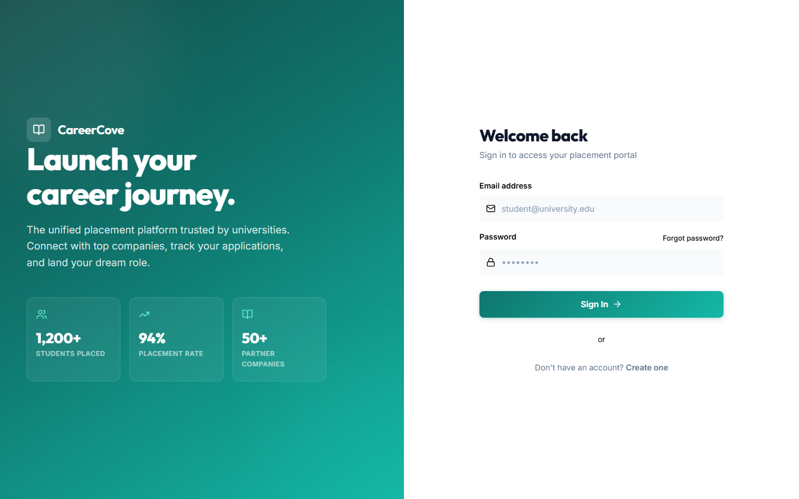
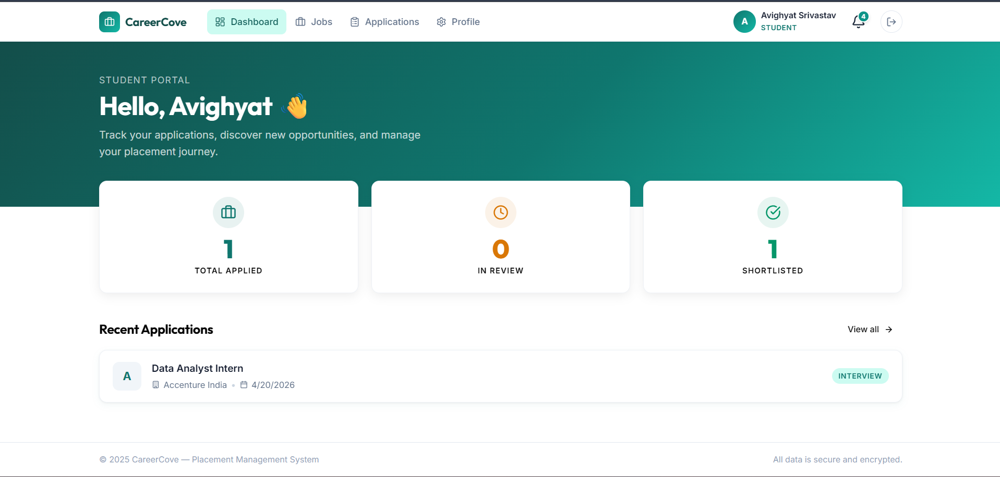
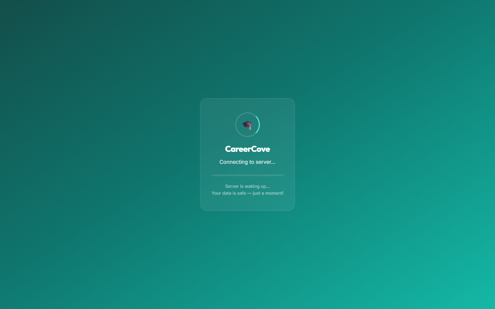

<div align="center">

# 🎓 CareerCove

**A Placement & Internship Management System**

[](https://reactjs.org/)
[](https://nodejs.org/)
[](https://expressjs.org/)
[](https://prisma.io/)
[](https://postgresql.org/)

[**Live Demo**](https://career-cove.vercel.app/login) · [**GitHub**](https://github.com/Vortex077/CareerCove)

</div>

---

> **⏳ First load may take ~30 seconds** — the backend is hosted on Render's free tier and sleeps after inactivity.

---

## 📖 About The Project

**CareerCove** is a fully-featured, job-centric application pipeline designed specifically for Training and Placement (T&P) coordinators and students. The platform streamlines the entire placement process, making it incredibly intuitive for coordinators to manage applicants per job, while providing an enriching and highly transparent experience for students to track their applications, view eligibility criteria, and explore detailed company profiles.

Designed with a focus on modern user experience, CareerCove provides premium UI/UX, responsive layouts, data visualizations, and robust authentication.

---

## 🎬 Demo Video

<!-- TODO: Record a 1-2 min demo with Loom or upload to YouTube (unlisted) and paste the link below -->

> 📹 **[Watch the Demo Video](#)** — A quick walkthrough of the key features.

---

## 🔑 Demo Credentials

Use these to explore the app without registering:

| Role                  | Email                         | Password    |
| --------------------- | ----------------------------- | ----------- |
| **Student**           | `demo.student@university.edu` | `Demo@1234` |
| **T&P Coordinator**   | `demo.tnp@university.edu`     | `Demo@1234` |

> ⚠️ _These are demo accounts with sample data. Please don't modify critical settings._

---

## 📸 Screenshots

<!-- TODO: Add screenshots of key pages. Drop PNGs in a screenshots/ folder and reference them here. -->

<details>
<summary>🔐 Login Page</summary>

<!--  -->

_Screenshot coming soon — or visit the [Live Demo](https://career-cove.vercel.app/login)_

</details>

<details>
<summary>🧑‍🎓 Student Dashboard</summary>

<!--  -->

_Screenshot coming soon_

</details>

<details>
<summary>👨‍💼 Admin Dashboard</summary>

<!--  -->

_Screenshot coming soon_

</details>

<details>
<summary>💼 Job Listings</summary>

<!--  -->

_Screenshot coming soon_

</details>

---

## 🚀 Key Features

- **🧑‍🎓 Student Portal**: Detailed job discovery, real-time application status tracking, profile management, and notification alerts.
- **👨‍💼 T&P Coordinator Dashboard**: Create and post job drives, manage student eligibility, track applications via robust reporting.
- **🏢 Company Management**: Detailed company profiles to help students research recruiters.
- **🔐 Role-Based Access Control (RBAC)**: Secure routes ensuring Admins, Companies, and Students only access what they are authorized to see.
- **📊 Analytics & PDF Reports**: Generate structured PDF reports and export placement analytics directly from the Admin dashboard.
- **📱 Responsive Design**: A dynamic UI built to be fully functional on both desktops and mobile devices, including engaging aesthetic micro-animations.

---

## 🛠️ Technology Stack

### Frontend

- **React.js (Vite)** — fast builds, HMR
- **CSS3** — custom design system with CSS variables, glassmorphism, micro-animations
- **React Router** — client-side routing
- **Context API** — global state & auth management
- **Axios** — API layer with token refresh interceptor

### Backend

- **Node.js** & **Express.js** — REST API
- **Prisma ORM** — fully-typed database access with migrations
- **PostgreSQL / Supabase** — relational database
- **JWT** — access + refresh token authentication
- **Helmet + Rate Limiting** — security hardening

### Deployment

- **Frontend** → Vercel
- **Backend** → Render (free tier)
- **Database** → Supabase (free tier PostgreSQL)
- **Keep-Alive** → GitHub Actions cron (every 12 h) + UptimeRobot (5 min interval)

---

## 📂 Architecture & Folder Structure

```bash
CareerCove/
├── .github/workflows/       # GitHub Actions (keep-alive cron)
├── backend/                  # Node.js + Express backend
│   ├── prisma/               # Prisma schemas and migrations
│   ├── src/
│   │   ├── controllers/      # Route controllers (logic)
│   │   ├── middlewares/      # Auth, Role, Upload guards
│   │   ├── routes/           # Express API endpoints
│   │   └── services/         # Core business logic processing
│   └── package.json
└── frontend/client/          # React Vite frontend
    ├── public/               # Static assets
    ├── src/
    │   ├── components/       # Reusable UI components
    │   ├── contexts/         # React Contexts (Auth, Notifications)
    │   ├── pages/            # View pages (Admin, Student, Auth)
    │   ├── services/         # API hooks & API communication
    │   └── styles/           # CSS design systems (Vars, Globals)
    └── package.json
```

---

## ⚙️ Getting Started

### Prerequisites

- Node.js (v16 or higher)
- PostgreSQL database (or Supabase instance)
- Git

### Local Setup Instructions

1. **Clone the repository**

   ```bash
   git clone https://github.com/Vortex077/CareerCove.git
   cd CareerCove
   ```

2. **Setup the Backend**
   - Navigate to the backend directory:
     ```bash
     cd backend
     ```
   - Install dependencies:
     ```bash
     npm install
     ```
   - Configure Environment Variables: Rename `.env.example` to `.env` and fill in your database credentials and JWT secret.
   - Run Prisma Migrations:
     ```bash
     npx prisma migrate dev
     ```
   - Start the backend server:
     ```bash
     npm run dev
     ```

3. **Setup the Frontend**
   - Open a new terminal and navigate to the frontend directory:
     ```bash
     cd frontend/client
     ```
   - Install dependencies:
     ```bash
     npm install
     ```
   - Start the development server:
     ```bash
     npm run dev
     ```

4. **Open your browser** to `http://localhost:5173` to explore CareerCove!

---

## 🚀 Deployment Notes

The free-tier hosting can pause or sleep. This project includes built-in mitigations:

1. **Health endpoint** (`/api/health`) — does a real DB query so Supabase stays active
2. **GitHub Actions cron** — pings the health endpoint every 12 hours
3. **UptimeRobot** — ping every 5 minutes to keep Render from sleeping (set this up manually at [uptimerobot.com](https://uptimerobot.com))
4. **ServerWakeUp component** — shows a friendly "waking up" overlay to visitors while Render cold-starts

---

<div align="center">
  <i>Built with ❤️ for modern placement management.</i>
</div>
